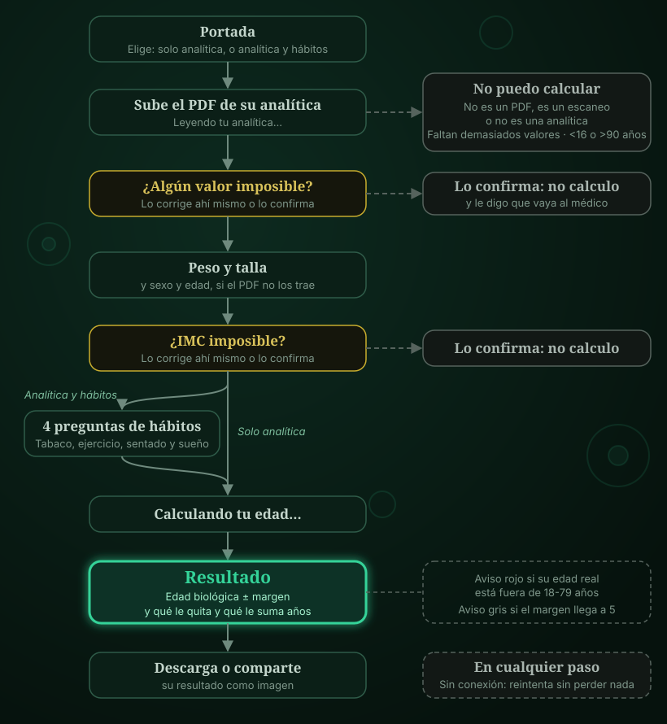
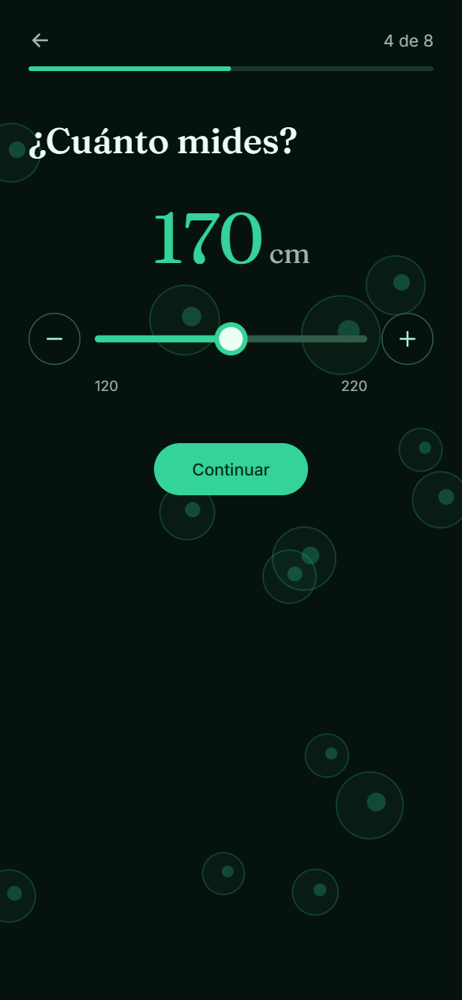

# Entrega 04: Diseño del frontal y experiencia de usuario

> **Nota:** esta entrega y la app que describe están en la rama [`phase-4`](https://github.com/rubengil-dev/TFM---Evolve/tree/phase-4), no en `main`. `main` solo recibe cada fase cuando está terminada.

## 1. Utilidad y valor del producto

### Para quién y qué problema resuelve
BioAge va dirigida a la población general: cualquier persona sin conocimientos médicos que, desde su casa, tenga uno de estos dos problemas:

- **Curiosidad.** La típica pregunta de "¿soy tan viejo como pone mi DNI?", es decir, ¿mi cuerpo tiene la edad que tengo yo?
- **Una analítica que no entiende.** Le llega una analítica del médico y no tiene muchas ganas de ponerse a mirarla, o no la entiende bien. Sube el PDF a la app y esta le dice qué edad tiene según esa analítica. Es una forma muy sencilla, sin tener que leer valores, de saber si la analítica dice que está bien o que está jodido.

### Qué hace el MVP y qué puede hacer el usuario con el resultado
El MVP tiene dos funcionalidades esenciales:
1. **Decirte tu edad biológica** y cuántos años está por encima o por debajo de tu edad real.
2. **Decirte qué partes de tu cuerpo (y de tus hábitos) te quitan o te suman años** frente a una persona típica de tu edad y sexo.

Así, si te sale una edad más baja de lo normal, puedes ver qué es lo que tienes mejor. Y si te sale muy alta, puedes saber de dónde viene.

Con eso, el usuario puede:
- Satisfacer su curiosidad, si era eso, y ya está.
- Corregir algo de su vida por su cuenta, si está claro qué es: si lo único que pasa es que fumo, dejo de fumar.
- Ir al médico, pero con algo de contexto.

La app no diagnostica ni recomienda nada: solo enseña lo que dicen los datos, y lo que se haga con ello lo decide el usuario.

## 2. Flujo de usuario

### Customer Journey
Hay dos flujos (prácticamente idénticos). Ir por uno u otro es la primera y única pregunta que se le hace al usuario al entrar: si quiere calcular su edad solo con la analítica, o con la analítica y sus hábitos.

1. **Elige el modo** en la portada.
2. **Sube el PDF** de su analítica.
3. **Contesta 2 preguntas:** peso y talla. Si el PDF no trae la edad o el sexo, se le preguntan también, así que pueden ser hasta 4.
4. **Solo en el modo con hábitos, contesta 4 preguntas más:** tabaco, ejercicio, horas sentado y horas de sueño.
5. **Ve su resultado**, y puede descargarlo o compartirlo como imagen.

Hasta el paso 3 el flujo es común a los dos modos. Las preguntas están pensadas para contestarlas sin escribir nada, solo tocando con el dedo o con el ratón, para que sea lo más sencillo posible. Es importante sobre todo en el modo con hábitos, que tiene más preguntas.

### Errores en el flujo
- **Al subir el PDF.** Se rechaza si no es un PDF, si es un escaneo (leerlo exige OCR, que queda para una versión futura), si no es una analítica o si no trae suficientes valores para calcular la edad con una fiabilidad mínima. También si la edad que trae es menor de 16 o mayor de 90.
- **Si algún valor de la analítica es imposible.** Lo más probable es que se haya leído mal. Justo después de leer el PDF, se le enseña el valor para que lo corrija en esa misma pantalla o confirme que es correcto. Si lo confirma, no calculo y le digo que vaya al médico.
- **Si el peso y la talla dan un IMC imposible.** El flujo se para al contestar el segundo de los dos, y se le pide que los corrija en esa misma pantalla. Si son reales, no calculo: no puedo estimar con fiabilidad la edad de alguien con ese IMC.
- **Si el servidor no responde.** Puede reintentarlo sin perder lo que ya ha contestado.

### Warnings
- **Edad real fuera de 18-79 años:** el modelo no ha visto a nadie de esas edades, así que el resultado lleva un aviso en rojo.
- **Margen ancho:** si el ± llega a 5 años, sale un aviso en gris que pide tomarlo con precaución. Pasa cuando faltan valores, y también en jóvenes con riesgo bajo, aunque la analítica esté completa.

## 3. Diseño del frontal

| Portada | Pregunta | Resultado |
|---|---|---|
|  |  |  |

> **Notas**
> - En [`frontend/README.md`](../../frontend/README.md) tienes un índice con todas las pantallas, también las de error, para abrir cualquiera directamente.
> - Los textos todavía no están cerrados al 100 %: quiero darle un toque de humor a cada error.

## 4. Experiencia de usuario

He aplicado los principios de Behavioral Economics: flujos lo más sencillos posible, con la menor cantidad de texto y de opciones, muy claros y con muy poca fricción.

### Portada
- En grande, qué hace la app; más pequeño, para quién.
- Solo 2 botones, uno por modo, y cualquiera de los dos te lleva al resultado. No hay absolutamente nada más.
- Lo que más resalta es el aviso amarillo de que no es consejo médico, porque quiero destacarlo.
- El aviso amarillo solo sale en la portada y en el resultado: si estuviera en todas las pantallas, pasaría a ser parte del fondo y nadie lo leería. Además, distrae y estorba para rellenar las preguntas.
- La letra pequeña sobre protección de datos va abajo, para que no se vea de primeras: solo la lees si quieres, y así no molesta ni distrae.

### Preguntas
Todas siguen el mismo patrón: la pregunta, corta y comprensible, y opciones en las que no hay que escribir, que es lo que más fricción genera en este tipo de flujos.
- **Números** (peso, talla, edad, horas): una barra gruesa para el ajuste grueso, y − y + en los extremos para el ajuste fino.
- **Opciones** (sexo, tabaco, ejercicio): tarjetas tipo test, explicadas con el menor texto posible y acompañadas de iconos.

Además, tocar el fondo crea o explota células. Hace el recorrido más entretenido, porque hay movimiento todo el rato: no son pantallas vacías, como el típico onboarding de un banco con las pantallas en blanco, que es un coñazo.

### Resultado
Es la pantalla más difícil de diseñar: he probado muchas cosas para que fuera clara y estética a la vez, sin aturullar con información.
- **La edad, arriba del todo y en grande.** Es lo más importante, y es donde los ojos miran primero.
- **La analítica y los hábitos, por separado.** En parte por temas técnicos, pero sobre todo por experiencia de usuario.
- **Cada uno, partido en "te quitan años" y "te suman años".** Al principio lo puse con signos, pero con tantos la pantalla se sobrecargaba y se entendía peor. Ahora los números van en valor absoluto: en verde lo que te quita años y en rojo lo que te suma. Sin leer nada ya sabes qué es bueno y qué es malo.

### Errores
El 90-95 % de los errores del flujo no son fallos técnicos de la app, sino algo que ha hecho el usuario y que le impide llegar al resultado. Por eso cada error se le dice **lo antes posible**, para que no rellene pasos y pasos y le salte al final. Cada error explica **qué está mal y por qué**.
- **Si hay algún valor incorrecto**, sale una ventanita, como un pop-up, donde lo corrige ahí mismo o dice que es correcto. Si dice que es correcto, salta la pantalla de error.
- **No hay una pantalla para revisar todos los valores leídos:** revisar veinte valores es justo el trabajo que la app quiere ahorrar. Solo enseño los que parecen imposibles.
- **Todas las pantallas de error** tienen su propia pantalla, con su visual, sus iconos, el mismo fondo y un texto en tono de humor que dice qué ha fallado y qué tiene que hacer.

### Resultados inciertos
Hay 3 implementaciones:
- **El ± junto a la edad.** Es la más importante: no solo te doy la edad, sino la edad con un margen de error. Por ejemplo, 30 ± 2 años significa que estás en torno a los 28-32. Es más ancho en la gente joven: como muere poca, es muy difícil predecir con precisión. En la gente mayor el margen es más bajo.
- **Aviso rojo si tu edad está fuera de 18-79 años.** El modelo nunca ha visto a nadie de esas edades: NHANES solo sigue la mortalidad de los adultos, y a partir de 80 años no da la edad exacta. Aun así, he ampliado los márgenes a 16, que es más o menos la edad del consentimiento sanitario, y a 90, porque la mayoría de la población muere antes, para que casi todo el mundo pueda tener su resultado. Fuera de 18-79 la desviación es mayor, y por eso sale el aviso de que, por tu edad, la precisión es más incierta.
- **Aviso gris si el ± llega a 5 años.** Pasa dentro de 18-79 cuando eres muy joven, porque el modelo trae una imprecisión por el sesgo de los datos, o cuando faltaban bastantes datos, pero no tantos como para dar error. El umbral de 5 es arbitrario: un margen de ± 5 son 10 años, una década, y lo he considerado como una generación. El aviso dice que esa edad no es tan precisa como suele ser, porque falta algún dato o porque eres muy joven.

### Accesibilidad
- Todo el recorrido usa un verde oscuro con letras blancas, así que se lee perfectamente.
- **Limitación actual:** en el resultado, el rojo y el verde se pueden confundir si eres daltónico. No te pierdes nada, porque el título de cada columna ya lo dice, pero queda como mejora para la versión 2.

### Privacidad
Restricción máxima y absoluta: no guardo absolutamente nada del usuario.
- Ni el PDF de la analítica, ni sus respuestas, ni siquiera el resultado. El servidor lee el PDF y calcula la edad en memoria, y lo descarta todo en cuanto responde. Lo demás vive en el navegador, y en cuanto el usuario lo cierra, se pierde.
- Solo genero un log de cada petición: qué modo ha usado, cuántos valores le faltaban y si ha salido error o no. Prácticamente nada más. He desactivado incluso el registro de la IP que hace uvicorn automáticamente.

Así no hay tratamiento de datos, y es lo que explica la letra pequeña que va debajo del aviso, a la que se llega con el típico ¹ de los textos legales.

## 5. Continuidad hacia el MVP final

### Qué está implementado
A 27 de noviembre de 2026, a las 00:10, esto es lo que ya funciona:
- **Todas las pantallas**, adaptadas al móvil: portada, preguntas, cargas, errores, ventana del valor imposible y resultado.
- **Front conectado al backend y a los modelos.** Se calcula la edad de verdad, con el modelo del nivel que toque.
- **Resultado completo:** edad biológica con su ±, años que suma o resta cada grupo de la analítica y de los hábitos, avisos rojo y gris, y descargar o compartir la imagen.
- **Todas las comprobaciones:** edades, valores imposibles, IMC imposible y mínimo de datos para calcular.
- **Logo, letra pequeña y logs** sin nada del usuario.
- **Índice de pantallas** para abrir cualquiera directamente.

### Plan para el MVP completo y funcional
- **Leer el PDF de verdad.** Es lo que más falta: ahora mismo cualquier PDF da los valores de una persona inventada. El parser normaliza los nombres (glucosa, gluc, GLU…) y las unidades de cada laboratorio, y se prueba con mis analíticas reales.
- **Desplegar**, en un hosting gratuito, para que se entre con un enlace.
- **Revisión final de todos los textos**, con el humor de los errores.
- **MLOps completo:** ahora mismo hay cosas de MLOps implementadas (tests, CI y trazabilidad de los modelos), pero faltan MLflow y DVC.

### Versión 2
Se plantea añadir:
- **Resultado apto para daltónicos**, sin depender del rojo y el verde.
- **Triglicéridos sin ayuno**, corrigiéndolos, además de los de ayunas.

La idea es que la versión 2 también esté lista para la entrega final del TFM. Si no da tiempo, la versión 1 estará completa, eso al 100 %. Y si fuera posible, también el OCR, en local, para que la analítica no salga del servidor.

### Futuras versiones
- **Leer fotos y escaneos** (OCR), no solo PDFs digitales.
- **Comparar dos analíticas** en el tiempo.

### Cómo conecta la interfaz con los datos y el modelo
El front (React) habla con un backend en Python (FastAPI) en tres pasos:
1. **Leer** (`/api/read`): recibe el PDF y devuelve los valores, la edad y el sexo si vienen, y los valores imposibles.
2. **Corregir** (`/api/correct`): comprueba los valores que el usuario ha corregido en la ventana.
3. **Calcular** (`/api/calculate`): recibe los valores y las respuestas y devuelve el resultado.

Para calcular, se usa uno de los cuatro modelos de la Entrega 03, según el modo y lo completa que sea la analítica:

| Modo | Analítica básica | Con al menos 3 de los 8 Extras (4 con hábitos) |
|---|---|---|
| Solo analítica | Nivel 1 | Nivel 2 |
| Analítica y hábitos | Nivel 3 | Nivel 4 |

El modelo da un riesgo, que se pasa a edad con la curva de referencia de NHANES de la Entrega 03. Como es un Cox, el riesgo es una suma de lo que aporta cada variable, así que se puede repartir por grupos y decir cuántos años suma o resta cada uno.
