# Entrega 04: Diseño del frontal y experiencia de usuario

BioAge es una web en la que subes el PDF de tu analítica y te dice tu **edad biológica**. Esta entrega explica cómo la usa una persona, cómo es cada pantalla y por qué.

En lugar de un mockup en Figma, he programado el frontal directamente en React (carpeta `frontend/`). Así lo que se diseña ahora es lo que se usará al final.

**Nota**: Las pantallas son reales y navegables, pero **los resultados que se ven son inventados**: el frontal todavía no está conectado al modelo (ver `punto 5`).

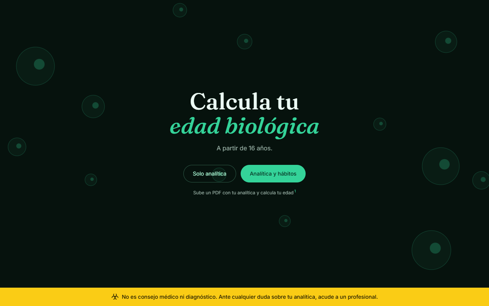

## 1. Utilidad y valor del producto

**Para quién?**
Para una persona en España, sin formación médica, que se ha hecho una analítica y quiere entenderla desde casa.

**Qué problema resuelve?**
Una analítica es una lista de valores con un rango al lado. Que todo salga "dentro de rango" no te dice si estás mejor o peor que otra persona de tu edad, e interpretar veinte valores sueltos exige conocimientos que la mayoría no tiene.

**Qué aporta frente a lo que existe?**
1. No hay que introducir los valores a mano: se leen del PDF.
2. Es gratis de verdad: sin registro, sin email y sin producto de pago detrás.
3. El resultado se entiende: una edad y qué la sube o la baja, en lugar de una tabla de valores.

**Funcionalidades esenciales del MVP:**

| Funcionalidad | Para qué |
|---|---|
| Subir el PDF de la analítica | Evitar escribir valores a mano |
| Dos modos: solo analítica, o analítica y hábitos | Que cada uno elija entre rapidez y un resultado más completo |
| Cuestionario corto | Pedir solo lo que el PDF no trae y los hábitos |
| Edad biológica y diferencia con la edad real | La respuesta principal |
| Qué te quita y qué te suma años | Entender de dónde sale el número |
| Descargar o compartir el resultado | Guardarlo, ya que la app no guarda nada |

**Qué podrá hacer el usuario con el resultado?**
- Saber si está mejor o peor que una persona típica de su edad y sexo.
- Ver qué partes de su analítica y qué hábitos pesan más.
- Guardarlo para compararlo con su próxima analítica.

Lo que **no** hace es diagnosticar ni recomendar suplementos o tratamientos. Solo observa los datos.

## 2. Flujo de usuario

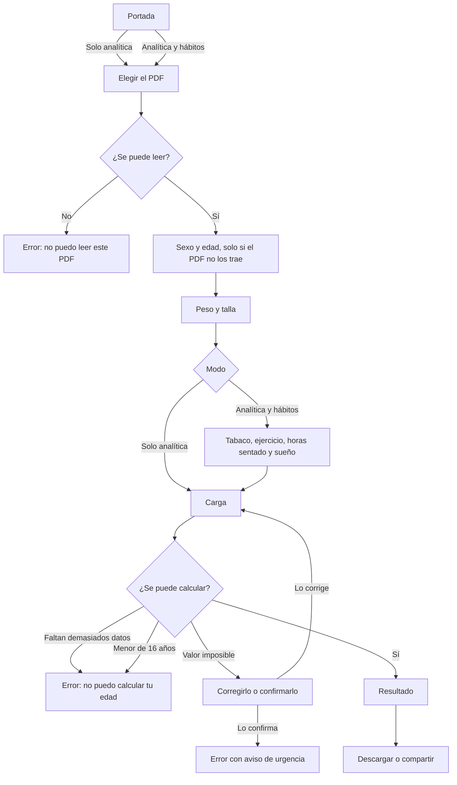

| Paso | Qué hace el usuario | Qué recibe |
|---|---|---|
| 1. Portada | Elige el modo | Se abre el selector de archivos |
| 2. PDF | Elige su analítica | La app lee los valores |
| 3. Preguntas | Responde de 2 a 8 preguntas, una por pantalla | Una barra le dice cuánto le queda |
| 4. Carga | Espera unos 2 segundos | Una animación mientras se calcula |
| 5. Resultado | Lee su edad y qué la explica | Edad biológica, diferencia y tablas |
| 6. Después | Descarga o comparte | Una imagen con su resultado |

**Por qué peso y talla en los dos modos?** El modelo usa el IMC y las analíticas casi nunca lo traen. El modo corto son 2 preguntas, y el largo, 6. Se añaden el sexo y la edad solo si el PDF no los trae.

## 3. Diseño del frontal

### 3.1 Portada

Un título que dice qué hace la app, dos botones y el aviso médico. El superíndice ¹ lleva a un texto que explica en lenguaje llano qué hago con los datos, cómo se calcula la edad y por qué no es un diagnóstico.

| Portada en el móvil | Lo que debes saber acerca de tus datos |
|---|---|
| 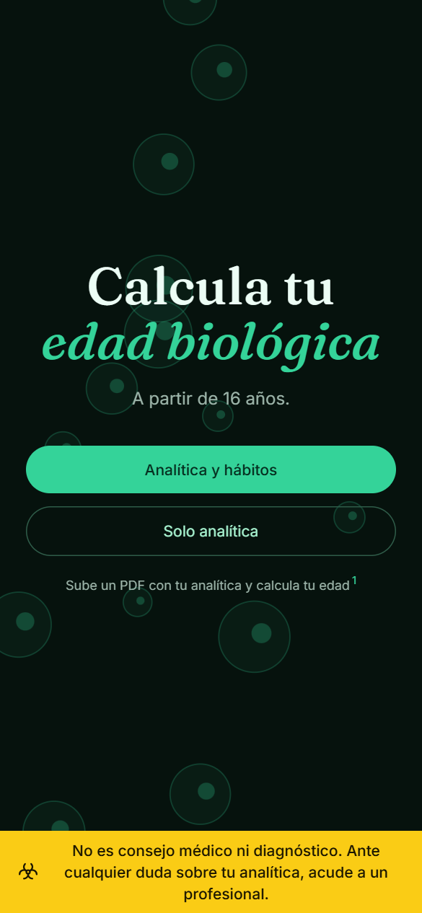 | 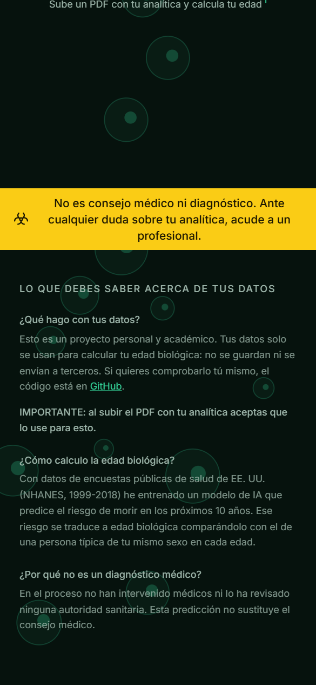 |

### 3.2 Preguntas y carga

| Opciones cortas | Números | Opciones con aclaración | Carga |
|---|---|---|---|
| 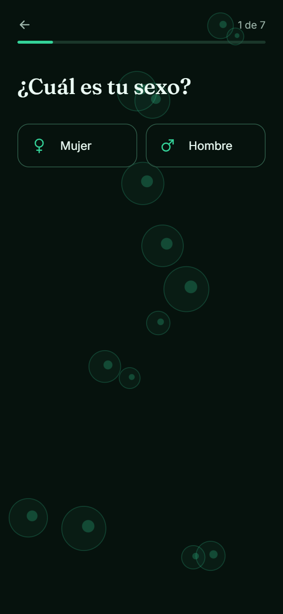 | 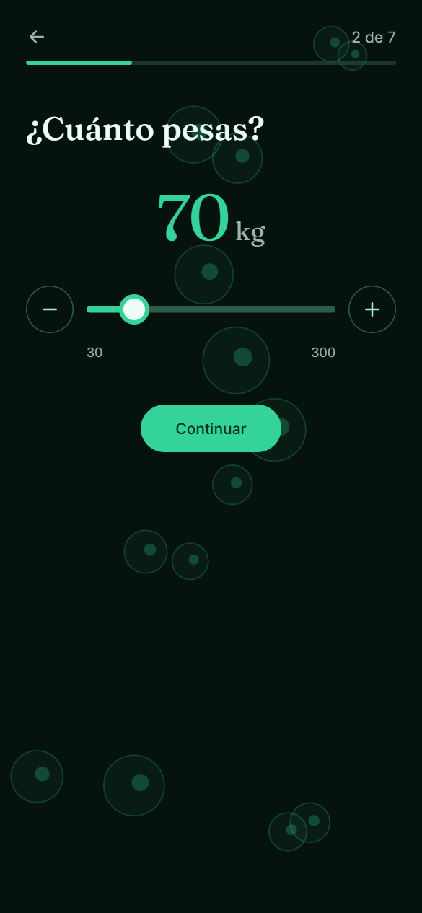 | 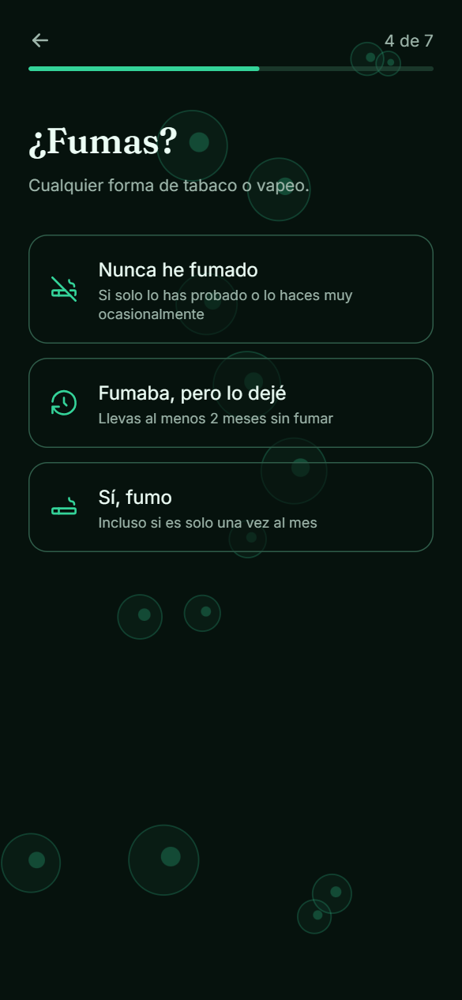 | 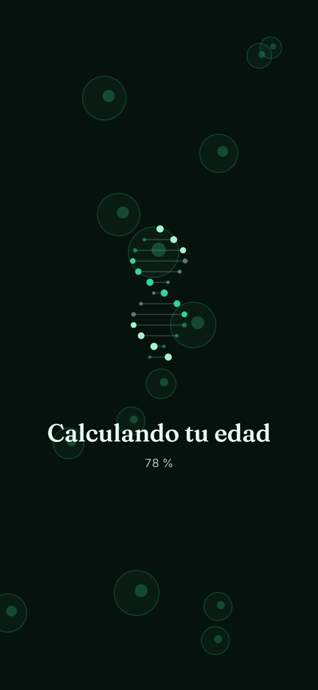 |

### 3.3 Resultado

Es la pantalla principal. De arriba abajo, de lo más importante a lo más detallado: la edad, la diferencia con la edad real y qué la explica.

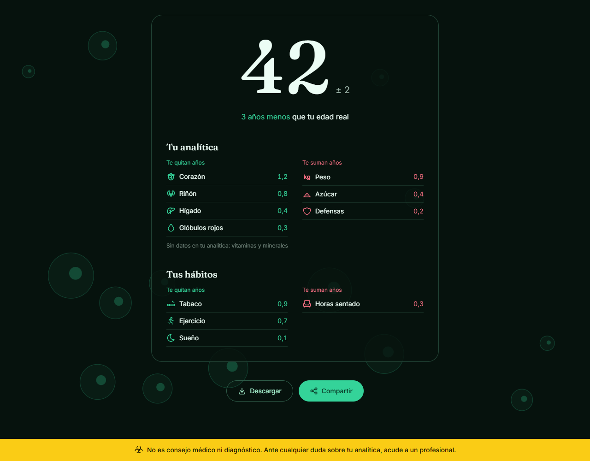

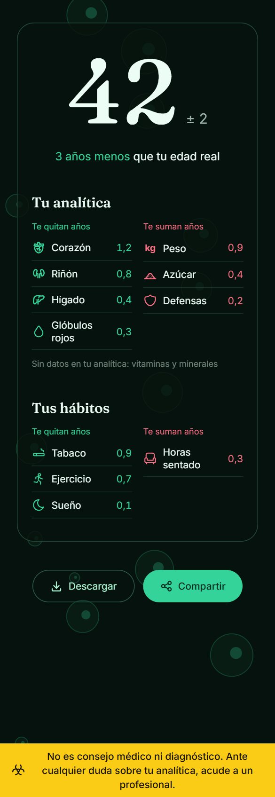

Cada fila es un **grupo** de variables del modelo, no una variable suelta. El número son los años que ese grupo suma o resta frente a una persona típica de la misma edad y sexo.

## 4. Experiencia de usuario

### 4.1 Decisiones de diseño

| Decisión | Por qué | Qué descarté |
|---|---|---|
| **La respuesta es un número enorme** | Es lo que el usuario viene a buscar | Un medidor en arco: ocupaba mucho y no aportaba nada |
| **Dos columnas: "te quitan años" y "te suman años"** | Que un valor negativo sea bueno confunde. Con la columna y el color no hacen falta signos | Gráfico de barras, tarjetas y pastillas: demasiada información |
| **Siempre los mismos grupos, y en lenguaje llano** (hígado, riñón, azúcar…) | Se entienden sin saber qué es la GGT, y no cambian de una persona a otra | Mostrar los mejores y peores parámetros de cada uno |
| **Años en vez de porcentajes** | Es la misma unidad que la respuesta principal | "Hígado al 97 %": el modelo no puntúa órganos, habría que inventar la escala |
| **Una pregunta por pantalla** | Se responde con el pulgar y sin agobiar | Un formulario largo |
| **Nada que escribir**, con tarjetas y barras | Es rápido en el móvil y evita erratas. La única excepción es corregir un valor mal leído | Cajas de texto |
| **Barra deslizable con − y +** | La barra para acercarse y los botones para ajustar | Fichas deslizables: demasiados toques para el peso o la talla |
| **Sin pantalla para revisar todos los valores** | Revisar veinte valores es justo el trabajo que la app quiere evitar | Revisión obligatoria. Volverá solo si las pruebas con PDFs reales demuestran que hace falta |
| **Botón destacado a la derecha** (arriba, si van apilados) | Cae más cerca del pulgar | |
| **Aviso médico solo en la portada y el resultado** | Si está siempre, se convierte en fondo y nadie lo lee | Dejarlo fijo en todas las pantallas |
| **Estética oscura y de microscopio** | Se asocia a biología y hace destacar la respuesta y el aviso amarillo | Una red de partículas, que parecía ingeniería, y una hélice de fondo, que distraía |

### 4.2 Facilidad de uso

- **Pensado para el móvil**, y adaptado al ordenador.
- **Contraste:** todos los textos principales superan 7:1 sobre su fondo, por encima del 4,5:1 que pide la norma de accesibilidad WCAG AA.
- **El color nunca va solo:** lo que suma y lo que resta se distingue también por la columna y su título.
- **Movimiento:** si el usuario tiene activado "reducir movimiento", el fondo se queda quieto.
- **Lenguaje:** sin jerga y en primera persona ("No puedo leer este PDF").

### 4.3 Errores

Cada error dice qué ha pasado y qué puede hacer el usuario.

| No se puede leer el PDF | Faltan datos | Menor de 16 años |
|---|---|---|
| 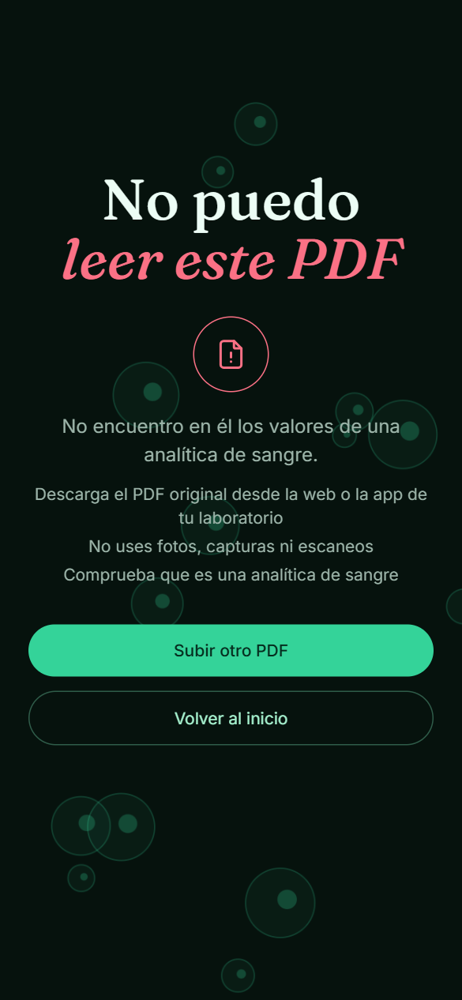 | 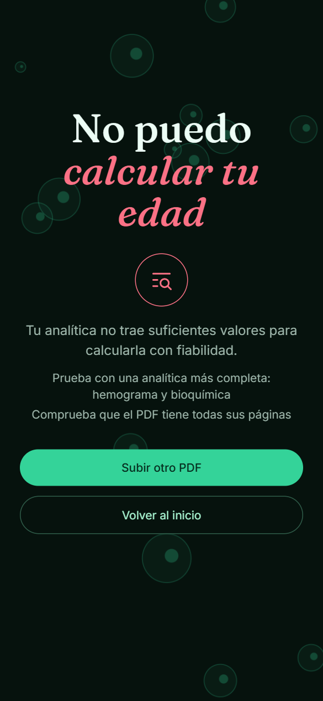 | 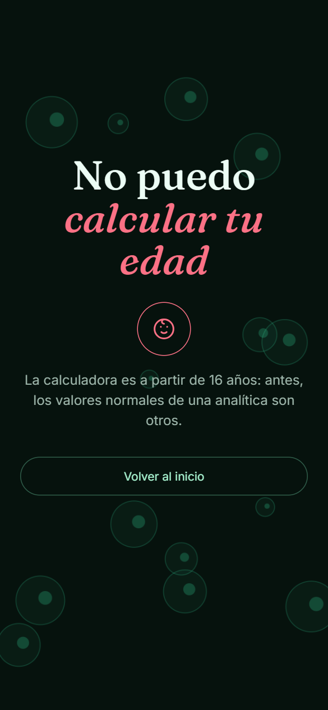 |

**Valor imposible.** Si un valor no es posible en una persona que va por su pie a hacerse una analítica (por ejemplo, un potasio de 9,8), lo más probable es que se haya leído mal. Se enseña el valor y se puede corregir. Si el usuario confirma que es correcto, no se calcula nada: dar una edad sería engañoso. Es el único caso en el que la app manda al médico con urgencia.

| Valor imposible | Si lo confirma |
|---|---|
| 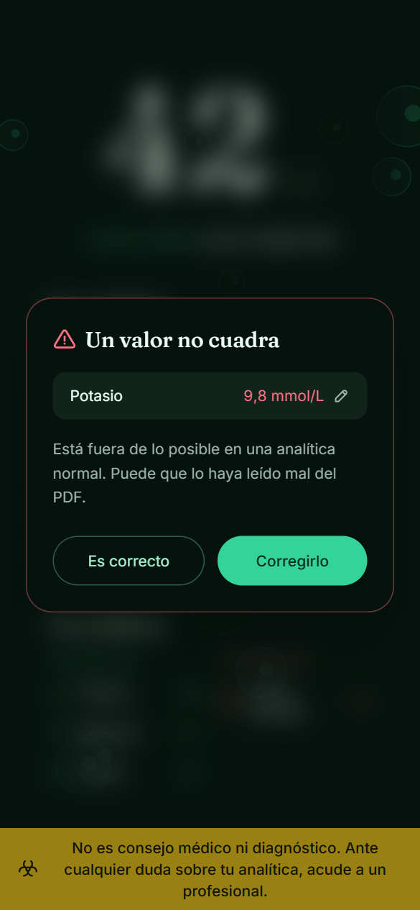 | 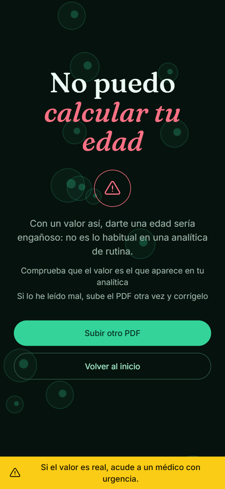 |

### 4.4 Resultados inciertos

- **Margen ±** junto a la edad, para que no parezca un valor exacto. Está en el diseño, pero todavía no he decidido cómo calcularlo. Si no encuentro un método que se sostenga, lo quitaré antes que enseñar un margen que no signifique nada.
- **Grupos sin datos** en una línea aparte, en vez de un 0 que parecería un resultado.
- **Edad real fuera de 18-79 años:** se calcula, con un aviso en rojo. El modelo no ha visto a nadie de esas edades.
- **Edades biológicas extremas:** por debajo de 18 o por encima de 90 se enseña "<18" o ">90", porque ahí la curva es una extrapolación.

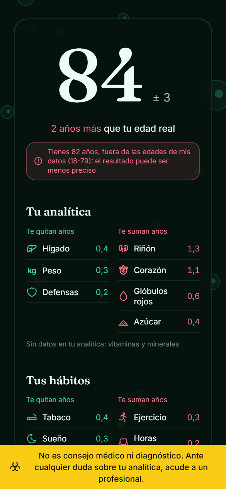

### 4.5 Privacidad

Los datos de salud son una categoría especial en el RGPD, así que condicionan el diseño:
- No hay registro y el diseño es no guardar nada: los datos se procesan en memoria y se descartan.
- No se usan etnia ni datos socioeconómicos.
- La imagen para compartir se crea en el navegador, sin pasar por el servidor.
- Las fuentes van dentro de la app, para que Google no sepa quién la visita.

## 5. Continuidad hacia el MVP final

### 5.1 Qué está hecho y qué falta

| Parte | Estado |
|---|---|
| Todas las pantallas, navegables y adaptadas al móvil | Hecho |
| Descargar y compartir la imagen del resultado | Hecho |
| Logo y cabecera | Para el MVP |
| Lectura del PDF, con los nombres y las unidades de cada laboratorio | Para el MVP |
| Backend que conecta el frontal con el modelo | Para el MVP |
| Años que aporta cada grupo | Para el MVP |
| Margen ± | Por decidir |
| Despliegue en una web pública | Para el MVP |

**Mejoras futuras:** comparar dos analíticas en el tiempo, leer fotos o escaneos, y otros idiomas.

### 5.2 Cómo conecta la interfaz con los datos y el modelo

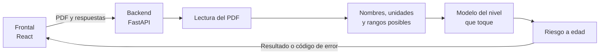

El backend será FastAPI, en Python como el modelo, y servirá también el frontal, así que habrá un solo despliegue.

**Qué modelo se usa.** Los cuatro niveles de la Entrega 03 encajan con los dos modos. Dentro de cada modo se usa el nivel más completo que permita la analítica:

| Modo | Analítica básica | Analítica ampliada |
|---|---|---|
| Solo analítica | Nivel 1 | Nivel 2 |
| Analítica y hábitos | Nivel 3 | Nivel 4 |

**De las preguntas al modelo:**

| Pregunta | Variable |
|---|---|
| Sexo y edad | `sex`, `age` |
| Peso y talla | `bmi` |
| Tabaco | `smoking`: `never`, `former`, `current` |
| Ejercicio | `physical_activity`: `intense`, `moderate`, `sedentary` |
| Horas sentado y de sueño | `sedentary_hours`, `sleep_hours` |

Los rangos de las barras son los mismos que los de `src/bioage/config/plausible_ranges.py`, salvo la edad, que va de 16 a 100 años.

**De las variables a los grupos del resultado** (propuesta, se cerrará al programarlo):

| Grupo | Variables del modelo |
|---|---|
| Vitaminas y minerales | vitamina D, sodio, potasio, cloro y fósforo |
| Azúcar | glucosa |
| Corazón | HDL y tensión arterial |
| Glóbulos rojos | hemoglobina, hematíes y CHCM |
| Defensas | neutrófilos, linfocitos y monocitos |
| Hígado | AST, ALT, GGT, fosfatasa alcalina, albúmina y LDH |
| Riñón | creatinina, urea, ácido úrico y cociente albúmina/creatinina en orina |
| Peso | IMC |

**De dónde saldrán los años de cada grupo.** El modelo es un Cox, que es una suma: cada variable aporta una parte del riesgo. Comparando esa parte con la de una persona típica de la misma edad y sexo, y pasándola a años con la curva de referencia de la Entrega 03, se obtiene cuánto suma o resta cada grupo. Es una de las razones por las que elegí Cox frente a XGBoost.

### 5.3 Qué cambia respecto a la Entrega 03

| En la Entrega 03 | Ahora | Por qué |
|---|---|---|
| Los mejores y peores parámetros de cada persona | Una tabla fija de grupos | Se entiende mejor y es igual para todos |
| Recomendar ir al médico por encima de un umbral | Sin mensaje, de momento | La franja del resultado ya lo indica. Falta decidir si se añade |
| Edades de 18 a 79 años | Desde los 16, con aviso fuera de 18-79 | La extrapolación en 16-17 es corta. Por debajo no se calcula |

### 5.4 Limitaciones que afectan a la interfaz

1. **Tabaco.** La pregunta incluye cualquier tabaco y el vapeo, pero la variable del modelo sale de las preguntas de NHANES sobre cigarrillos. Al resto se le aplica el efecto del fumador de cigarrillos.
2. **Sueño y horas sentado.** Se pregunta la media de la semana, y NHANES preguntaba el sueño entre semana. Las horas sentado incluyen estar tumbado, y NHANES solo hablaba de estar sentado.
3. **Tensión arterial.** El modelo la admite, pero las analíticas no la traen y el flujo no la pregunta. Si falta, se rellena con la de una persona típica y no suma ni resta.
4. **Jóvenes.** En riesgo bajo el modelo infraestima (Entrega 03), así que a un joven le puede salir una edad biológica demasiado baja.
5. **Sin pruebas con usuarios.** Las decisiones de diseño son razonadas, pero todavía no las he contrastado con personas ajenas al proyecto.
